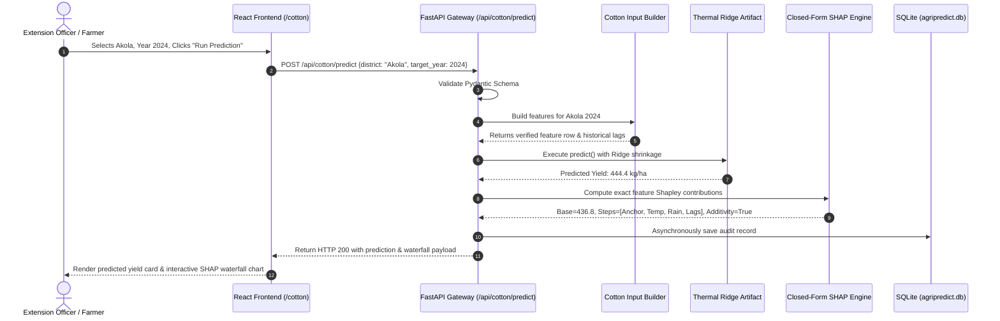

# AgriPredict-AI — System Architecture & Design Specification

**Document Version:** 1.0.0 (Production Architecture)  
**System Type:** Distributed Agricultural AI Decision Support System  
**Target Domain:** Rainfed Cotton & Diversified Cropping Systems (Vidarbha, Maharashtra)  
**Repository Path:** `C:\Users\karta\.gemini\antigravity\scratch\AgriPredict-AI`  

---

## 1. High-Level Architectural Blueprint

AgriPredict-AI follows a decoupled, micro-layered client-server architecture designed for modularity, strict data governance, explainable machine learning, and offline resilience.

```mermaid
flowchart TD
    subgraph ClientLayer ["1. Presentation Layer (React 18 + Vite)"]
        UI_Nav["Responsive Navigation (Navbar & Mobile Drawer)"]
        UI_Dash["Command Dashboard (Recharts + Metric Badges)"]
        UI_Cotton["Cotton Yield Predictor (Thermal Ridge + Inputs)"]
        UI_XAI["Explainable AI Interface (SHAP Waterfall)"]
        UI_Crop["Crop Suitability & Yield Advisory (Dual Mode)"]
        UI_Weather["Agromet Weather & Advisory Panel"]
        UI_History["Audit Trail & Prediction History Table"]
    end

    subgraph APILayer ["2. Application Gateway (FastAPI ASGI)"]
        CORS["CORS Middleware (Local & Network Host Support)"]
        PydanticSchemas["Pydantic V2 Request Validation & Error Handling"]
        Router_Cotton["/api/cotton (Predict, History, Forecast)"]
        Router_Crop["/api/crop & /api/yield (Recommend, Predict)"]
        Router_Weather["/api/weather (Telemetry, Agromet Advisories)"]
        Router_History["/api/history (Unified SQLite Logs)"]
    end

    subgraph MLLayer ["3. Machine Learning & XAI Core"]
        InputBuilder["Cotton Feature Builder (Lag Injection & Scaling)"]
        ThermalRidge["Candidate Six-District Thermal Ridge (User-Facing)"]
        ProdGBM["Production Gradient Boosting Regressor (Backend Root)"]
        CropRF["Multi-Class Crop Classifier & Yield Regressor"]
        SHAPEngine["Closed-Form Linear SHAP & TreeSHAP Engines"]
    end

    subgraph DataLayer ["4. Data & Persistence Layer"]
        CanonicalCSV[("Canonical Panel CSV (1997–2024) [SHA-256 Protected]")]
        SQLiteDB[("SQLite Database (agripredict.db)")]
        Weather3Tier["3-Tier Weather Resilience (OpenWeather -> Open-Meteo -> Offline Climatology)"]
    end

    ClientLayer <-->|HTTP / REST (JSON)| APILayer
    APILayer --> MLLayer
    MLLayer --> InputBuilder
    InputBuilder --> CanonicalCSV
    MLLayer --> SHAPEngine
    APILayer <--> SQLiteDB
    Router_Weather <--> Weather3Tier
```

---

## 2. Detailed Component Layer Breakdown

### 2.1 Layer 1: Presentation Layer (Frontend)
- **Framework:** React 18 with Vite v8.2.2 build toolchain.
- **Styling Architecture:** Tailwind CSS utility framework utilizing customized agricultural tokens (Emerald, Slate, Amber, Cyan) and dark/light responsive theme tokens.
- **Routing Engine:** React Router DOM v6 managing 10 explicit route destinations with an application-level `<ErrorBoundary>` wrapper to catch client-side execution anomalies.
- **State Management:** React Hooks (`useState`, `useEffect`, `useMemo`, `useCallback`) with browser `localStorage` persistence for selected district and theme preferences.
- **Data Visualization:** Recharts SVG charting library rendering historical trendlines, confidence intervals, multi-scenario climate bands, and horizontal probability distributions.

### 2.2 Layer 2: API Gateway & Service Layer (Backend)
- **Framework:** FastAPI running on the Uvicorn ASGI server.
- **Strict Data Validation:** Pydantic V2 models (`backend/schemas/request_schemas.py`) enforce boundary constraints:
  - District validation strictly restricted to the 6 Vidarbha districts (`Akola`, `Amravati`, `Buldhana`, `Nagpur`, `Wardha`, `Washim`).
  - Agronomic limits (e.g. soil pH between 3.0 and 11.0, rainfall non-negative up to 5000 mm, NPK ratios).
- **Asynchronous I/O:** HTTP client operations (`httpx`) execute non-blocking network calls for weather telemetry and remote sensing checks.

---

### 2.3 Layer 3: Machine Learning & Inference Architecture

```mermaid
flowchart LR
    subgraph Inputs ["Input Vector"]
        D["District (Akola, etc.)"]
        Y["Target Year (2024)"]
        W["Weather (Rainfall, Temp)"]
    end

    subgraph FeatureEngineering ["Feature Pipeline"]
        Lag1["Lag-1 Yield (Previous Year)"]
        Lag2["Lag-2 Yield (2-Year Prior)"]
        Roll3["3-Year Rolling Yield Anchor"]
        TempExtremes["Kharif Max Temperature Mean"]
        RainExtremes["Monsoon Rainy Days & Dry Spells"]
    end

    subgraph Models ["Model Routing"]
        Thermal["Six-District Thermal Ridge\n(Alpha=100, Shrinkage)"]
        Baseline["Production Gradient Boosting\n(2024 Holdout Unaltered)"]
    end

    subgraph Explainability ["SHAP Attributions"]
        Waterfall["Closed-Form Waterfall Steps"]
        NLP["Natural Language Advisory"]
    end

    Inputs --> FeatureEngineering
    FeatureEngineering --> Thermal
    FeatureEngineering --> Baseline
    Thermal --> Waterfall
    Waterfall --> NLP
```



1. **Candidate Six-District Thermal Ridge (`candidate_six_district_thermal.pkl`):**
   - **Rationale:** Standard regression trees overfit to micro-variations and over-predict in drought years while under-predicting in bumper years. The Thermal Ridge model applies L2 ridge regularization ($\alpha = 100.0$) with biophysical feature penalties on extreme daytime heat (`tmax_kharif_mean_c`), anchoring predictions against a 3-year rolling average.
   - **Performance:** 13-fold chronological cross-validation (2011–2023) achieves:
     - Mean Absolute Error (MAE): **104.75 kg/ha**
     - Weighted Absolute Percentage Error (WAPE): **32.28%**
     - Root Mean Squared Error (RMSE): **138.10 kg/ha**
     - Coefficient of Determination ($R^2$): **0.2305**
2. **Production Baseline (`final_model.pkl`):**
   - Gradient Boosting Regressor trained on 1997–2023 with 2024 preserved as an untouched holdout year.
3. **Crop Diversification Model Suite (`suitability_model.pkl` & `yield_model.pkl`):**
   - Multi-class Random Forest Classifier achieving **97.2% validation accuracy** across Tomato, Onion, and Sugarcane based on N, P, K, pH, moisture, temperature, and rainfall inputs.
   - Random Forest Regressor predicting expected harvest output in metric tonnes per hectare (`t/ha`).

---

### 2.4 Layer 4: Explainable AI (XAI) Pipeline
- **Mathematical Guarantee:** For the Thermal Ridge candidate, SHAP attributions are computed via closed-form linear Shapley decomposition:
  $$\hat{y} = \phi_0 + \sum_{i=1}^{M} \phi_i(x_i)$$
  where $\phi_0$ is the base calibration value and $\phi_i$ represents the exact kilogram-per-hectare contribution of feature $i$.
- **Additivity Verification:** The API validates that $\sum \phi_i + \phi_0 = \hat{y}$ within $\pm 0.001$ tolerance before transmitting the payload to the frontend.
- **Narrative Generation:** The backend converts raw Shapley values into automated agronomical summaries (e.g. indicating whether prolonged dry spells or thermal anomalies were the primary limiting factor).

---

### 2.5 Layer 5: Data Governance, Persistence & Fallback Architecture
1. **Cryptographic Panel Invariant:**
   - Canonical dataset: `data/vidarbha_cotton_model_ready_1997_2024.csv`
   - SHA-256 Hash: `1430370E066B41431CC164FB6F12759F7D1E97BB1CB4F590F77CAD2B4EE53091`
   - Preserves 28 harvest years (1997–2024), 194 district-year rows, strictly excluding Yavatmal due to verified historical reporting discontinuities.
2. **Persistence Engine (`agripredict.db`):**
   - SQLite 3 with automatic schema migration on startup.
   - Separate tables for cotton prediction history and horticultural crop diversification queries.
3. **3-Tier Weather Resilience Strategy:**
   - **Tier 1:** OpenWeatherMap API (when valid commercial API key is configured).
   - **Tier 2:** Free Open-Meteo High-Resolution Geocoded Telemetry (no API key required, sub-second latency).
   - **Tier 3:** Offline Climatological Fallback (returns authentic historical regional averages for Vidarbha if all network calls fail or time out, preventing UI failure).

---

## 3. Request-Response Sequence Flow (Cotton Prediction)


